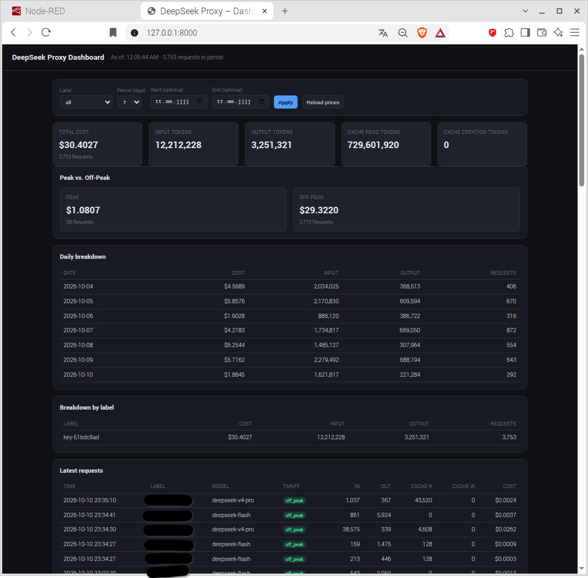

# DeepSeek API Proxy & Token Monitor

> **Independent open-source project.** This project is not affiliated with,
> developed, sponsored, endorsed, or operated by DeepSeek (深度求索).

An **Anthropic Messages-compatible proxy for the DeepSeek API** that captures
reported token usage from API responses and turns it into request-level cost
and usage analytics. The repository also includes a desktop monitor for the
DeepSeek account balance.

The proxy is the core component: it makes request-level token accounting
available to compatible clients without requiring DeepSeek's own application
or harness. The monitor is the user-facing companion for reviewing the data.

## What it does

- **Proxies Anthropic Messages API requests to DeepSeek** and streams responses
  back to the client.
- **Captures usage reported by DeepSeek**, including input, output and cache
  token fields, from streamed Server-Sent Events (SSE) responses.
- **Calculates request-level costs** from captured usage and the configured
  DeepSeek price table, including cache-hit/cache-miss and peak/off-peak rates.
- **Stores data locally in SQLite** and can additionally write it to InfluxDB
  2.x for multi-host reporting.
- Provides a local web dashboard, a Tkinter detail view, and a desktop
  balance monitor.

Cost figures are calculated from the usage fields actually returned by the API
and the price table currently configured in the proxy. Verify the tariff table
and review the limitations around historical pricing and the annual Chinese
public-holiday calendar before treating figures as financial records.

## Compatible clients and scope

The proxy listens locally at http://127.0.0.1:8000 by default. Configure a
client that supports a custom Anthropic Messages-compatible base URL to use
http://127.0.0.1:8000/anthropic as its base URL.

Examples include VS Code with a custom model endpoint (e.g. GitHub Copilot
Chat), GitHub Copilot CLI using its Anthropic-provider BYOK configuration, and
Claude Code configured with a custom Anthropic Messages endpoint. Compatibility
and tool use depend on the client and model versions; Copilot CLI's documented
provider list names Anthropic rather than DeepSeek, and Anthropic does not
officially support Claude Code against non-Claude models. See the configuration
examples in [docs/INSTALLATION.md](docs/INSTALLATION.md) and the clients' own
documentation.

**Important scope distinction:** the upstream provider is DeepSeek. This is
not a generic multi-provider router and it does not forward requests to
Anthropic's hosted Claude models. It allows a compatible Claude client to use
DeepSeek as its backend.

The proxy exposes these POST endpoints:

- /anthropic/v1/messages
- /v1/messages (alias)

It forwards the request body and response body without decoding/re-encoding
them. Necessary HTTP transport headers are filtered or regenerated, so the
proxy should not be described as byte-for-byte transparent at the full HTTP
message level.

## Components

| Component | Path | Purpose |
|---|---|---|
| **API proxy** | deepseek-proxy/ | DeepSeek upstream, streaming usage capture, SQLite and optional InfluxDB |
| **Desktop monitor** | deepseek_rates.py | Tkinter UI for balance and cost/usage analytics |
| **Monitor logic** | deepseek_monitor/ | Tariff, configuration, persistence and analytics modules |

## Architecture

```text
Compatible client
(VS Code / Copilot / Claude Code)
           |
           | Anthropic Messages API
           v
DeepSeek API Proxy  ------->  DeepSeek API
      |      |
      |      +--> Usage extraction from SSE stream
      |
      +--> SQLite (local, always)
      |
      +--> InfluxDB 2.x (optional, multi-host)
                    ^
                    |
          Monitor / dashboard
```

- SQLite is always enabled for proxy usage records.
- InfluxDB is optional and receives usage records in addition to SQLite.
- The monitor can read local proxy data or a central InfluxDB source.
- The proxy does not store the client's raw API key in the usage database;
  it records a one-way fingerprint for grouping requests.

## Screenshots

| Main widget | Cost & Usage | Settings |
|---|---|---|
|  |  |  |


## Quick start

Linux example:

```bash
git clone --branch main https://github.com/Kletternaut/DeepSeek-Monitor.git
cd DeepSeek-Monitor/deepseek-proxy
python3 -m venv .venv
.venv/bin/pip install -r requirements.txt
.venv/bin/python main.py
```

The proxy dashboard is then available at http://127.0.0.1:8000/.

For the full steps—including VS Code configuration, systemd, Windows packaging
and InfluxDB—see [docs/INSTALLATION.md](docs/INSTALLATION.md).

## Security

The proxy and dashboard have no built-in authentication. By default they bind
to loopback (127.0.0.1); do not expose them to a LAN or the Internet without
an appropriate access-control and transport-security layer. See
[docs/SECURITY.md](docs/SECURITY.md).

The proxy's web dashboard (`http://127.0.0.1:8000/`) — recorded token usage and
the costs calculated from it:



## Documentation

| File | Content |
|---|---|
| [docs/INSTALLATION.md](docs/INSTALLATION.md) | Install proxy and monitor, configure clients, systemd and Windows |
| [docs/WINDOWS_SETUP.md](docs/WINDOWS_SETUP.md) | Build and test Windows .exe files |
| [docs/INFLUXDB.md](docs/INFLUXDB.md) | InfluxDB integration and multi-host reporting |
| [docs/STRUCTURE.md](docs/STRUCTURE.md) | Repository directory/file reference |
| [docs/changelog.md](docs/changelog.md) | Change history |
| [docs/CONTRIBUTING.md](docs/CONTRIBUTING.md) | Contribution guide |
| [packaging/README.md](packaging/README.md) | Windows packaging |

## License

MIT — see [LICENSE](LICENSE).
