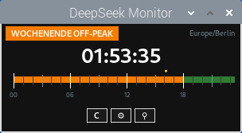
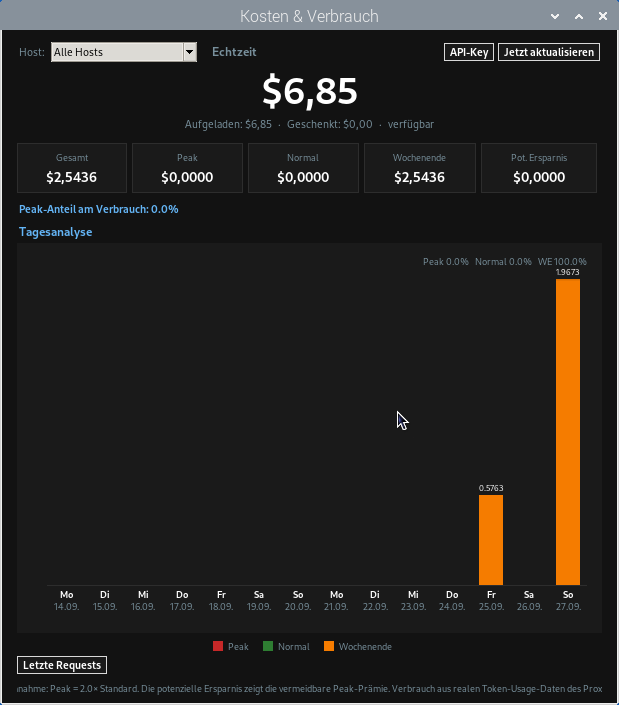
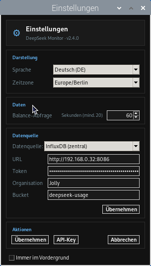
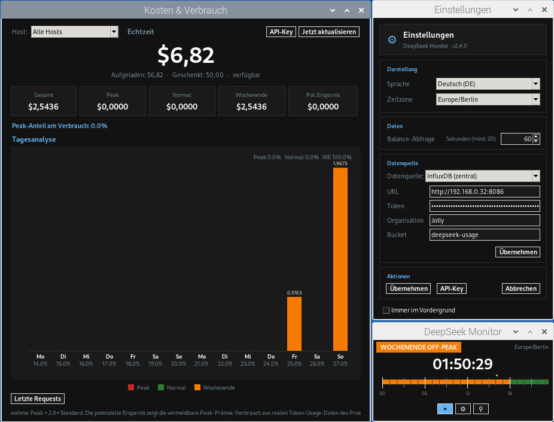

# DeepSeek-Monitor

> **Note:** This project is an independent open-source project and is in **no
> way affiliated with DeepSeek (深度求索)**. It is not developed, sponsored,
> endorsed, or operated by DeepSeek.

Monitor DeepSeek API usage — consisting of two components:

| Component | File | Purpose |
|---|---|---|
| **Proxy** | `deepseek-proxy/` | Streaming proxy (VS Code → DeepSeek), records token usage, writes SQLite + optionally InfluxDB |
| **Monitor** | `deepseek_rates_latest.py` → `deepseek_rates_v2.4.0.py` | Tkinter app "Cost & Usage", reads from the local proxy/SQLite or a central InfluxDB |

## Architecture

```
Host A (VS Code + Proxy) ─┐
Host B (VS Code + Proxy) ─┼─► InfluxDB 2.x (permanent) ◄─ Monitor "Cost & Usage"
Host C (VS Code + Proxy) ─┘        (write)                 (read)
```

- **The proxy always writes** SQLite, plus InfluxDB if `influx.env` is present
  (`DEEPSEEK_INFLUX_URL/TOKEN/ORG/BUCKET`).
- **The monitor reads** either "Local (Proxy/SQLite)" or "InfluxDB (central)"
  depending on the GUI setting.

## Screenshots

The monitor app (Tkinter) — main tariff widget, "Cost & Usage" window, settings
and the full overview:

| Main widget | Cost & Usage | Settings |
|---|---|---|
|  |  |  |



## Documentation

| File | Content |
|---|---|
| [`INSTALLATION.md`](INSTALLATION.md) | Installation (proxy, monitor, systemd, VS Code) |
| [`INFLUXDB.md`](INFLUXDB.md) | InfluxDB 2.x integration in detail |
| [`STRUCTURE.md`](STRUCTURE.md) | Directory/file reference |

## Quickstart

```bash
git clone --branch main https://github.com/Kletternaut/DeepSeek-Monitor.git
cd DeepSeek-Monitor/deepseek-proxy
python3 -m venv .venv && .venv/bin/pip install -r requirements.txt
sudo cp deepseek-proxy.service /etc/systemd/system/
sudo systemctl enable --now deepseek-proxy
```

For the full steps (including `influx.env`, VS Code setup and starting the
monitor): see **[`INSTALLATION.md`](INSTALLATION.md)**.

## License

MIT — see [LICENSE](LICENSE).

## Contributing

See [CONTRIBUTING.md](CONTRIBUTING.md).
